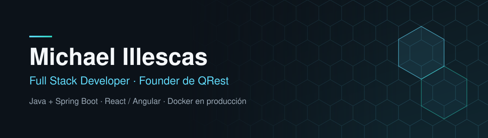
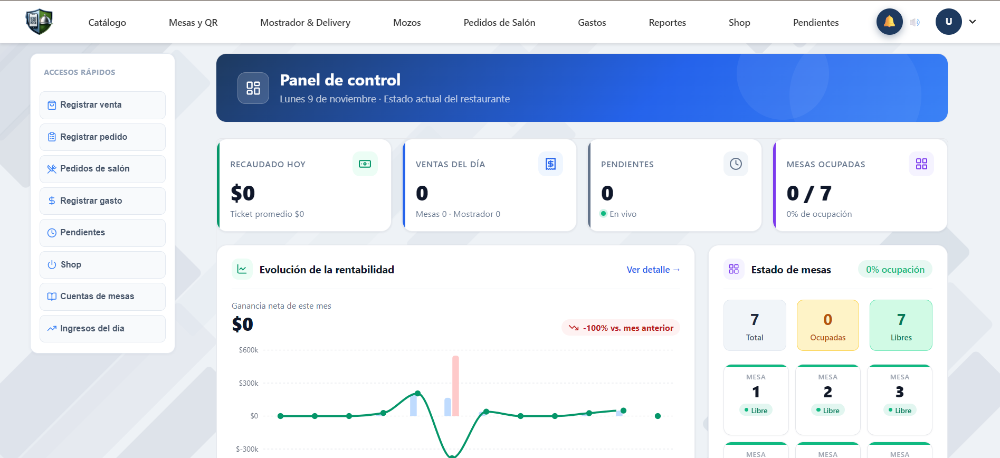
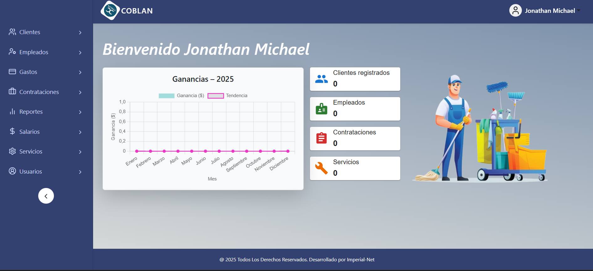
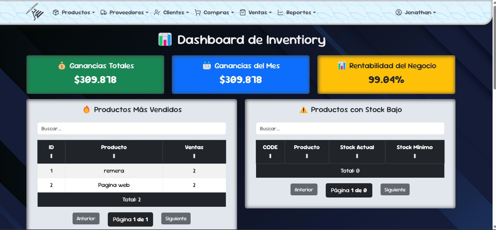
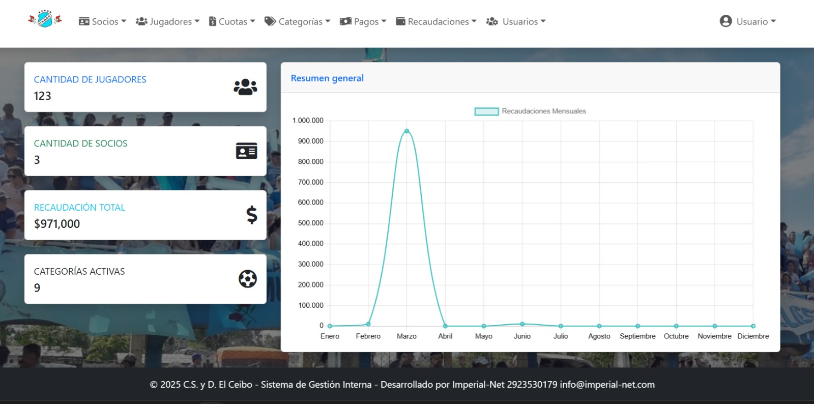
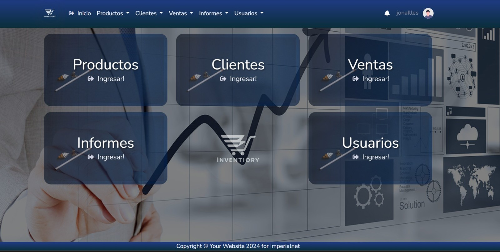
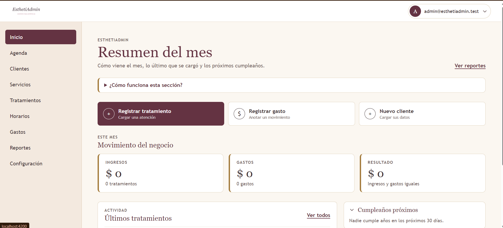
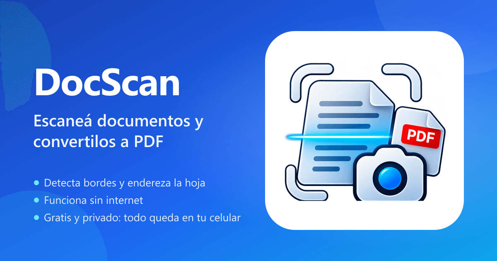

  
  
  

  Desarrollo aplicaciones web de punta a punta y las despliego yo mismo en producción. 
  Soy fundador de <strong>QRest</strong>, un SaaS gastronómico con clientes activos, y trabajo de forma independiente bajo <strong>Imperial Net</strong>.

<h2>Producto principal</h2>

<table>
  <tr>
    <td width="55%"></td>
    <td width="45%">
      <h3><a href="https://qrest.com.ar/">QRest</a></h3>
      
Plataforma SaaS para la gestión gastronómica: mesas y pedidos en tiempo real, menú digital con QR, pedidos online, venta rápida, portal de mozos y reportes de ventas.

      
<code>Java 21</code> <code>Spring Boot</code> <code>React</code> <code>TypeScript</code> <code>WebSocket</code> <code>MySQL</code>

      
<a href="https://qrest.com.ar/"><strong>qrest.com.ar</strong></a>

    </td>
  </tr>
</table>

<h2>Sistemas</h2>

<table>
  <tr>
    <td width="50%" valign="top">
      
      <h3><a href="https://github.com/MichaelIllescas/coblan-system">Coblan System</a></h3>
      
Administración de empresas de servicios facturados por hora: contrataciones con cronograma, sueldos, comprobantes y balance real del negocio.

      
<code>Spring Boot</code> <code>Spring Security</code> <code>React</code> <code>MySQL</code>

    </td>
    <td width="50%" valign="top">
      
      <h3><a href="https://github.com/MichaelIllescas/inventiory">Inventiory</a></h3>
      
ERP para PyMEs: productos, proveedores, compras, ventas, presupuestos, cuentas corrientes y reportes de rentabilidad.

      
<code>Spring Boot</code> <code>Spring Security</code> <code>React</code> <code>MySQL</code>

    </td>
  </tr>
  <tr>
    <td width="50%" valign="top">
      
      <h3><a href="https://github.com/MichaelIllescas/club-manager">Club Manager</a></h3>
      
Administración de clubes deportivos: socios, jugadores por categoría, cuotas, pagos y recaudaciones.

      
<code>Spring Boot</code> <code>Spring Security</code> <code>React</code> <code>MySQL</code>

    </td>
    <td width="50%" valign="top">
      
      <h3><a href="https://github.com/MichaelIllescas/inventiory-thymeleaf">Inventiory Thymeleaf</a></h3>
      
Gestión de stock y ventas para comercios pequeños. La primera versión de Inventiory, como aplicación monolítica.

      
<code>Spring Boot</code> <code>Spring Data JPA</code> <code>Thymeleaf</code> <code>MySQL</code>

    </td>
  </tr>
  <tr>
    <td width="50%" valign="top">
      
      <h3><a href="https://github.com/MichaelIllescas/esthetiadmin">EsthetiAdmin</a></h3>
      
Gestión para centros de estética: agenda de turnos, reserva online pública sin registro, clientes, tratamientos, gastos y reportes financieros.

      
<code>Spring Boot 4</code> <code>Java 25</code> <code>Angular</code> <code>Flyway</code> <code>Docker</code> <code>MySQL</code>

    </td>
    <td width="50%" valign="top">
      
      <h3><a href="https://docscan.imperial-net.com">DocScan</a></h3>
      
PWA para escanear documentos con la cámara y exportarlos a PDF. Detecta los bordes con OpenCV en un Web Worker, aplica filtros y funciona offline, todo en el dispositivo.

      
<code>React 19</code> <code>TypeScript</code> <code>Vite 6</code> <code>Tailwind</code> <code>OpenCV.js</code> <code>pdf-lib</code>

      
<a href="https://docscan.imperial-net.com"><strong>docscan.imperial-net.com</strong></a>

    </td>
  </tr>
</table>

También desarrollé <a href="https://github.com/MichaelIllescas/SistemaRegistroDetenidos"><strong>SDRP</strong></a>, un sistema de registro de detenidos penales para seccionales policiales.

<h2>Tecnologías</h2>

    
  

<h2>Cómo trabajo</h2>

<table>
  <tr>
    <td width="33%" valign="top">
      <h4>Arquitectura</h4>
      
Backends organizados por módulos de negocio y casos de uso, con Clean Architecture y Hexagonal cuando el producto lo justifica.

    </td>
    <td width="33%" valign="top">
      <h4>Producción</h4>
      
Me ocupo también del despliegue: Docker, Nginx y servidores Linux, con sistemas que usan clientes reales.

    </td>
    <td width="33%" valign="top">
      <h4>Recorrido</h4>
      
Técnico Superior en Desarrollo de Software, cursando la Licenciatura en TI. Antes, 10 años en seguridad pública.

    </td>
  </tr>
</table>
